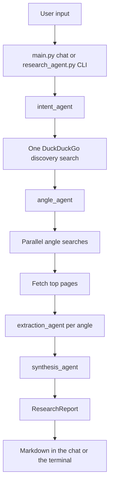

# Pydantic AI Deep Research Agent

A local research app. You enter a stock ticker or a free-text question. A Pydantic AI pipeline searches DuckDuckGo, reads the strongest pages, and returns one structured report with citations.

Use it in the browser at `http://127.0.0.1:7860`, or from the terminal. Both paths call the same `research()` function in `research_agent.py`.

Examples:

- `NVDA` is read as a ticker and resolved to the company, its industry, and the products around it (NVIDIA, semiconductors, GPUs, AI).
- `NASDAQ:NVDA` and `BRK.B` are tickers too.
- `solid-state battery manufacturing` is a general research question.
- A sentence that only mentions a ticker is still a general question.

## Key features

- Ticker and free-text input. A ticker is the whole message. Anything else is a research question.
- Company resolution for tickers, including industry and product context.
- One discovery search, then 3 or 4 research angles that cover different ground.
- Stock angles start from SWOT, the last 12 months of performance, competition and market position, and the latest quarter plus guidance. The planner replaces an angle when the search results show a sharper question.
- Parallel follow-up searches. Each angle gets its own DuckDuckGo query.
- Page fetch. Up to three results per angle are downloaded and converted to markdown.
- Source ranking. SEC filings and investor-relations pages come first for financials. Reuters, AP, Bloomberg, the Financial Times, the Wall Street Journal, and similar outlets come next for news. Social and video hosts are skipped.
- Citations. Every evidence bullet keeps the claim, the source title, and the URL. Claims that do not cite a retrieved page are dropped.
- A single report: executive summary, one section per angle, risks and uncertainties, conflicting information, and what to watch next.
- Local Gradio chat. The page shows a status line while the run is in progress, then replaces it with the report.
- Terminal entry point for the same report.

## Architecture

`main.py` is the chat page. `research_agent.py` is the pipeline. Four Pydantic AI agents run in order. Search and page reading happen in Python, so the model cannot skip a step.



| Stage | Component | What it produces |
| --- | --- | --- |
| Input | `main.py` or `research_agent.py` | The ticker or question |
| 1. Intent | `intent_agent` | `QueryIntent`: ticker or general, company or subject, context |
| 2. Discovery | `DuckDuckGoSearchTool` | One result list. A resolved ticker is searched as symbol plus company name |
| 3. Plan | `angle_agent` | `ResearchPlan`: 3 or 4 non-overlapping angles. Overlaps are rejected and planned again |
| 4. Deep dive | `DuckDuckGoSearchTool` and `WebFetchLocalTool` | Sources for each angle, searched at the same time, then the top pages as text |
| 5. Extract | `extraction_agent` | `AngleFindings`: findings, cited evidence, uncertainties |
| 6. Synthesize | `synthesis_agent` | Title, executive summary, risks, conflicts, and what to watch next |
| Output | `render_report()` | The markdown report |

The summary, risks, conflicts, and watch list are written only from the extracted notes. Section findings and citation URLs are copied through unchanged.

`weather_agent.py` is a separate Pydantic AI example. The chat does not call it.

## Prerequisites

- Windows, macOS, or Linux
- Python 3.10 or newer (`py -3 --version` on Windows)
- An OpenAI API key
- Internet access for DuckDuckGo, page fetches, and the OpenAI API

## Setup

Run these steps from the project folder (`pydantictest`).

1. Confirm Python:

   ```bash
   py -3 --version
   ```

2. Install the packages:

   ```bash
   py -3 -m pip install "pydantic-ai-slim[duckduckgo,web-fetch,openai]" python-dotenv "gradio>=6.7.0"
   ```

3. Create `.env` in the project folder. `.gitignore` already excludes it.

   ```dotenv
   OPENAI_API_KEY=your-key-here
   ```

4. Optional. Change the model by adding this line to `.env`. The default is `openai:gpt-5-mini`.

   ```dotenv
   RESEARCH_MODEL=openai:gpt-5-mini
   ```

`load_dotenv()` runs before any agent is constructed, because Pydantic AI reads `OPENAI_API_KEY` at construction time.

## Run the chat page

1. Start the app:

   ```bash
   py -3 main.py
   ```

2. Read the local URL printed in the terminal. It is `http://127.0.0.1:7860` when that port is free. If 7860 is busy, the app binds the next free port through 7869.

3. Open that URL in a browser.

4. Type a ticker or a question in the box and submit. The examples `NVDA`, `TSLA`, and `solid-state battery manufacturing` only fill the box. Submit to start the run.

5. Wait. The chat first says research is running. The full report replaces that message when the pipeline finishes. A run usually takes a few minutes and spends OpenAI credits.

6. Stop the server with Ctrl+C in the terminal. Start `main.py` again after code changes. An already open page keeps the process that was running when you launched it.

## Run from the terminal

Same report, printed in the console. No browser.

```bash
py -3 research_agent.py NVDA
py -3 research_agent.py "solid-state battery manufacturing"
```

Pass the whole question as one argument. Quote it when it contains spaces.

## Report contents

Every successful run prints these parts:

- Title
- Original query
- Intent: `ticker` or `general`, plus the resolved subject
- Context, such as semiconductors, GPUs, and AI
- Executive summary
- One section per angle, each with key findings, evidence bullets (`claim`, source title, URL), and uncertainties for that section
- Risks and uncertainties
- Conflicting information, or a line that none was recorded
- What to watch next

`research()` returns the structured `ResearchReport`. `render_report()` turns that object into the markdown shown in the chat and the terminal.

## Project layout

| File | Role |
| --- | --- |
| `main.py` | Gradio chat. Calls `research()` and displays `render_report()` |
| `research_agent.py` | Agents, DuckDuckGo search, page fetch, ranking, and the report |
| `weather_agent.py` | Standalone weather example from the Pydantic AI docs |
| `.env` | `OPENAI_API_KEY` and optional `RESEARCH_MODEL` |
| `.gitignore` | Keeps `.env` out of git |
| `pyproject.toml` | Project name and dependencies |

## Weather example

Optional. It is the [Pydantic AI weather agent](https://ai.pydantic.dev/examples/getting-started/weather-agent/) and is not part of the research flow.

```bash
py -3 -m pip install logfire
py -3 weather_agent.py
```

The script asks about London and Wiltshire. Its tools call public demo endpoints, so the temperature and description are demo data. `logfire` is required for this script. The research chat runs without it.

## If something fails

- **Port already in use.** Stop the other `main.py` with Ctrl+C, or use the new URL printed when the app moves to 7861–7869.
- **Missing API key.** Add `OPENAI_API_KEY` to `.env` and start the app again.
- **`No results found`.** DuckDuckGo returned nothing before the timeout. Search waits 20 seconds and retries twice. Submit the query again.
- **Report never replaces the status line.** Leave the page open. The pipeline is still searching and calling the model.
